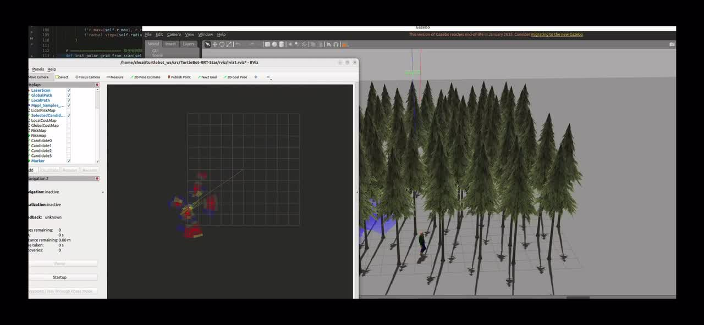
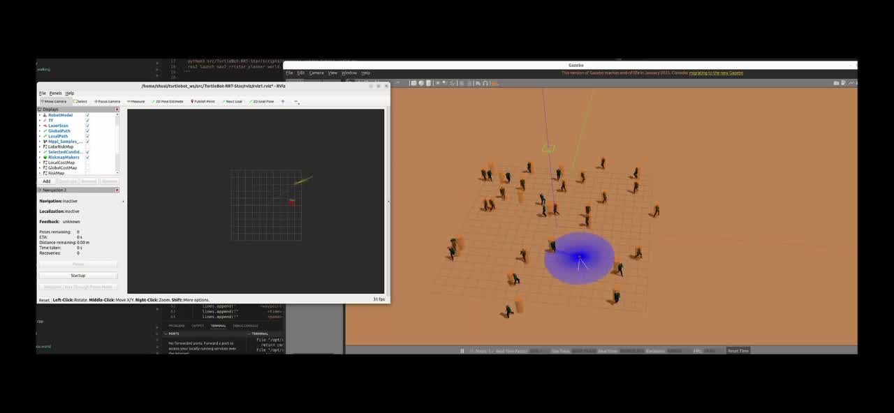
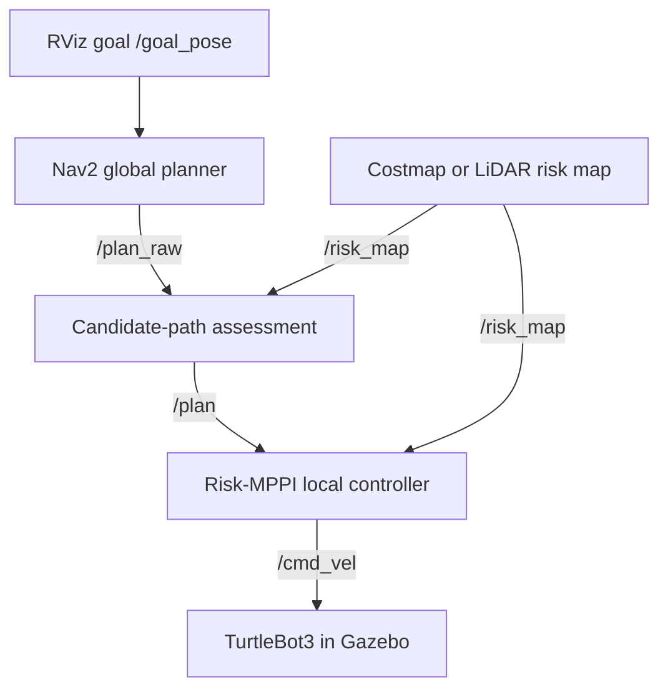
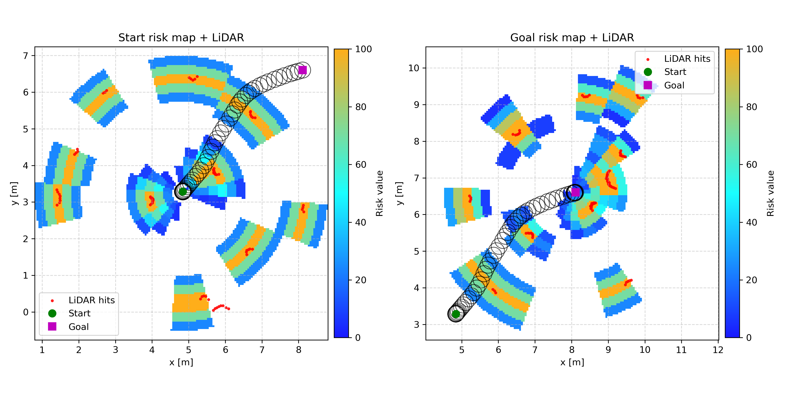

# Risk-MPPI

**Risk-aware mobile robot navigation with ROS 2, Nav2 and Model Predictive Path Integral control.**

Risk-MPPI combines global planning, risk-map construction, candidate-path assessment and sampling-based local control for a TurtleBot3 in Gazebo Classic. RViz displays the selected path, sampled trajectories and risk distribution while the robot navigates among static obstacles and moving pedestrians.

## Demonstrations

Click a preview to open the original video.

| Forest environment | Pedestrian environment |
| --- | --- |
| [](docs/videos/357.mp4) | [](docs/videos/358.mp4) |
| [Watch video · 31 s](docs/videos/357.mp4) | [Watch video · 38 s](docs/videos/358.mp4) |

The recordings show Gazebo and RViz together, including the robot, surrounding obstacles and navigation visualizations.

## Features

- **Global planning:** Nav2's NavFn planner with A* enabled generates a reference path. The repository also includes an RRT* global-planner plugin under the project namespace.
- **Risk maps:** choose a local-costmap-based risk field or a LiDAR-based risk map. Both publish `/risk_map`.
- **Candidate-path assessment:** generate lateral alternatives around the reference path and rank them by length, risk and uncertainty.
- **MPPI local control:** evaluate sampled control sequences with map-based costs; support Gaussian and log-normal sampling, with CUDA acceleration through PyCUDA.
- **Dynamic scenes:** generate pedestrian worlds, move cylinders and add pedestrian torso proxies for sensor visibility.
- **Visualization:** display global/local paths, candidate paths, MPPI samples and risk markers in RViz.

## Navigation pipeline



The Python MPPI controller drives the robot. In the documented workflow, Nav2's `controller_server` supplies the local costmap; its velocity output is remapped to `/cmd_vel_nav`. Goals are sent through RViz's **2D Goal Pose** tool rather than the Nav2 NavigateToPose action.

## Repository layout

| Location | Contents |
| --- | --- |
| `src/Risk-MPPI/nodes/` | MPPI controller, goal-to-plan bridge, risk-map builders, path assessor and visualization nodes |
| `src/Risk-MPPI/tools/` | World generation, obstacle spawning and pedestrian proxies |
| `src/Risk-MPPI/experiments/` | Preserved alternative controllers, diagnostics and earlier versions |
| `src/Risk-MPPI/launch/` | Gazebo, manual Nav2 and alternative-controller launch files |
| `src/Risk-MPPI/world/`, `models/`, `robot/`, `rviz/` | Simulation and visualization resources |
| `src/Risk-MPPI/src/`, `include/` | RRT* global-planner implementation, renamed `RiskGlobalPlanner` |
| `src/humans_actor_plugins/` | Gazebo actor plugin |
| `tools/env.sh` | Per-terminal environment setup |
| `docs/videos/`, `docs/images/` | Demonstration videos and previews |

The repository and source directory are named **Risk-MPPI**. The ROS package is **`nav2_risk_mppi`**, following ROS package naming conventions. TurtleBot3 names remain where they identify the robot or its installed dependencies.

## Requirements

- Ubuntu 22.04 and **ROS 2 Humble**.
- **Gazebo Classic 11**, Gazebo ROS integration and TurtleBot3 simulation packages.
- Nav2, including NavFn and the Nav2 MPPI controller plugin used by `nav2_params.yaml`.
- Python 3.10 with NumPy, SciPy and Jinja2.
- For GPU execution: an NVIDIA GPU, compatible driver, CUDA toolkit with `nvcc`, and PyCUDA installed for the Python interpreter running the controller.

The controller includes a CPU fallback when PyCUDA cannot be imported. The demonstration configuration uses 1,024 samples at 30 Hz; The CPU path caps sampling at 48 trajectories; performance depends on the machine. CUDA initialization or compilation errors require fixing the GPU environment.

## Installation

Clone the repository as a ROS workspace. The examples use `~/risk_mppi_ws`; the repository can live elsewhere.

```bash
git clone https://github.com/ShuaiChen817/Risk-MPPI.git ~/risk_mppi_ws
cd ~/risk_mppi_ws
# Deactivate Conda first if it is active; ROS Humble uses system Python.
source /opt/ros/humble/setup.bash

sudo apt install \
  python3-colcon-common-extensions python3-rosdep \
  python3-numpy python3-scipy python3-jinja2 \
  ros-humble-navigation2 ros-humble-nav2-bringup \
  ros-humble-nav2-mppi-controller ros-humble-gazebo-ros-pkgs \
  ros-humble-turtlebot3-gazebo

# Requires an initialized rosdep installation.
rosdep update
rosdep install --from-paths src --ignore-src -r -y

colcon build --symlink-install --cmake-args \
  -DBUILD_TESTING=OFF -DPython3_EXECUTABLE=/usr/bin/python3
source tools/env.sh
```

If rosdep has never been initialized, run `sudo rosdep init` before `rosdep update`. For GPU execution, install a compatible CUDA toolkit and PyCUDA in this same Python environment. Python dependencies are listed in [requirements.txt](requirements.txt).

## Run the project

### Step 0 — environment in every terminal

Run this in **each terminal** before its launch command:

```bash
source ~/risk_mppi_ws/tools/env.sh
cd "$RISK_MPPI_WS"
```

`env.sh` selects system Python, sources ROS and the workspace, selects the Waffle Pi model and adds the project's Gazebo model/plugin paths. If you cloned elsewhere, change the path in the `source` command.

Optionally regenerate the pedestrian world **before starting Gazebo**:

```bash
python3 "$RISK_MPPI_PKG/tools/generate_random_humans_world.py"
```

This overwrites `world/three_walking_humans.world` with 30 randomized actors. Change `N_ACTORS` and the sampling bounds in the generator to customize the scene.

### Terminal 1 — Gazebo and robot

```bash
ros2 launch nav2_risk_mppi world.launch.py \
  world:="$RISK_MPPI_PKG/world/three_walking_humans.world"
```

The explicit `world` argument loads the source file, including any freshly generated actors. Other worlds can be selected by changing this path.

### Terminal 2 — planner and local costmap

```bash
ros2 launch nav2_risk_mppi manual_navigation.launch.py \
  params_file:="$RISK_MPPI_PKG/nav2_params.yaml" \
  use_sim_time:=true
```

This launch file starts only `planner_server` and `controller_server`, without a lifecycle manager. It replaces the previous `nav2_bringup navigation_launch.py ... use_lifecycle_mgr:=False` command: that argument does not disable the manager in Humble's standard navigation launch file.

### Terminal 3 — lifecycle configuration and activation

Wait for Gazebo's robot, `/scan` and the odometry TF to become available. Then run:

```bash
ros2 service call /planner_server/change_state lifecycle_msgs/srv/ChangeState '{transition: {id: 1}}'
ros2 service call /planner_server/change_state lifecycle_msgs/srv/ChangeState '{transition: {id: 3}}'

ros2 service call /controller_server/change_state lifecycle_msgs/srv/ChangeState '{transition: {id: 1}}'
ros2 service call /controller_server/change_state lifecycle_msgs/srv/ChangeState '{transition: {id: 3}}'

ros2 lifecycle get /planner_server
ros2 lifecycle get /controller_server
ros2 lifecycle get /local_costmap/local_costmap
```

Both servers should be `active`. Controller activation normally activates its local costmap too. **Only if the local costmap is still `inactive`**, run:

```bash
ros2 service call /local_costmap/local_costmap/change_state lifecycle_msgs/srv/ChangeState '{transition: {id: 3}}'
```

### Terminal 4 — RViz goal to global path

```bash
python3 "$RISK_MPPI_PKG/nodes/goal_pose_to_plan.py" \
  --ros-args -p use_sim_time:=true
```

The bridge sends `/goal_pose` to `/compute_path_to_pose` and publishes the result on `/plan_raw`.

### Terminal 5 — choose one risk-map source

Local-costmap-based risk map:

```bash
python3 "$RISK_MPPI_PKG/nodes/risk_map_builder.py" \
  --ros-args -p use_sim_time:=true
```

**Or**, LiDAR-based risk map:

```bash
python3 "$RISK_MPPI_PKG/nodes/scan_risk_map_builder.py" \
  --ros-args -p use_sim_time:=true
```

Run one builder at a time because both publish `/risk_map`.

### Terminal 6 — CUDA environment and MPPI controller

For GPU execution, adjust `CUDA_HOME` to your installed toolkit:

```bash
export CUDA_HOME=/usr/local/cuda
export PATH="$CUDA_HOME/bin:$PATH"
export LD_LIBRARY_PATH="$CUDA_HOME/lib64${LD_LIBRARY_PATH:+:$LD_LIBRARY_PATH}"
unset PYCUDA_DEFAULT_NVCC_FLAGS

which nvcc
nvcc --version
python3 -c 'import pycuda.autoinit; import pycuda.driver as cuda; print(cuda.Context.get_device().name())'

python3 "$RISK_MPPI_PKG/nodes/test_mppi.py" \
  --ros-args -p use_sim_time:=true
```

Keep only one MPPI/local controller publishing `/cmd_vel`. The preserved `log_mppi_node.py` and other controller variants are alternatives to `test_mppi.py`.

### Terminal 7 — dynamic obstacles or pedestrian proxies

Moving cylinders:

```bash
python3 "$RISK_MPPI_PKG/tools/spawn_and_move_cylinders.py" \
  --n 8 --xmin -6 --xmax 6 --ymin -6 --ymax 6 \
  --clearance 0.6 --z 0.0 \
  --sdf "$RISK_MPPI_PKG/world/cylinder_model/model.sdf" \
  --ax 0.6 --by 0.4 --omega 0.35 --rate 30
```

Alternatively, use the included pedestrian model:

```bash
python3 "$RISK_MPPI_PKG/tools/spawn_and_move_cylinders.py" \
  --n 8 --xmin -6 --xmax 6 --ymin -6 --ymax 6 \
  --clearance 0.6 --z 0.0 \
  --sdf "$RISK_MPPI_PKG/models/person_walking/model.sdf" \
  --prefix human_ --ax 0.6 --by 0.4 --omega 0.35 --rate 30
```

For the animated actors in the generated world, use torso proxies instead:

```bash
python3 "$RISK_MPPI_PKG/tools/humans_torso_proxies.py" --autospawn
```

Choose the obstacle setup appropriate to the scene. These tools use their own command-line parsers, so the commands above omit ROS parameter arguments.

### Terminal 8 — candidate-path assessment

```bash
python3 "$RISK_MPPI_PKG/nodes/global_path_assessor.py" \
  --ros-args -p use_sim_time:=true
```

This node evaluates `/plan_raw` against `/risk_map` and publishes the selected path on `/plan`. The MPPI node receives its reference path from this topic.

### Terminal 9 — RViz

```bash
rviz2 -d "$RISK_MPPI_PKG/rviz/rviz1.rviz" \
  --ros-args -p use_sim_time:=true
```

Keep **Fixed Frame = `odom`**. Use **2D Goal Pose** to set a target. The bridge expects goals in `odom`; it does not perform a TF conversion for goals supplied in another frame. Candidate topics `/candidate_path_0` through `/candidate_path_4` can be added or enabled as Path displays.

### Terminal 10 — risk-map markers

```bash
python3 "$RISK_MPPI_PKG/nodes/riskmap_marker_viz.py" \
  --ros-args -p use_sim_time:=true
```

## Configuration and operation

| Setting | Location / default |
| --- | --- |
| Global planner | `nav2_params.yaml`: `nav2_navfn_planner/NavfnPlanner`, `use_astar: true` |
| Alternative RRT* plugin | `nav2_risk_mppi/RiskGlobalPlanner`; not selected by the default YAML |
| Candidate lateral offsets | `global_path_assessor.py`: `[-0.6, -0.3, 0.0, 0.3, 0.6]` m |
| Path ranking weights | length `1.0`, risk `3.0`, uncertainty `2.0` |
| MPPI samples / horizon | `test_mppi.py`: `1024` / `1.1` s |
| MPPI control frequency | `30.0` Hz |
| Risk-map topic | `/risk_map` |

The renamed C++ global planner retains its **RRT*** algorithm. The **MPPI** algorithm is implemented in `nodes/mppi_controller.py` and used by the Python controller nodes.

The candidate-path assessor currently ranks paths by soft costs; its hard risk-threshold rejection block is disabled in the preserved implementation. Path offsets are geometric alternatives rather than a collision-certified replanning method. The MPPI controller applies its own map-based collision/risk costs.

To stop, press **Ctrl+C** in the running terminals, starting with the controller. Restart Gazebo and the navigation launch files, then repeat the lifecycle transitions when resetting a run.

If no motion or visualization appears, check:

```bash
ros2 lifecycle get /planner_server
ros2 lifecycle get /controller_server
ros2 topic list
ros2 topic info /cmd_vel --verbose
ros2 run tf2_ros tf2_echo odom base_link
```

- No `/plan_raw`: check planner activation and use the RViz **2D Goal Pose** tool.
- No `/plan`: start the candidate-path assessor and verify its input topics.
- No `/risk_map`: start exactly one builder and check `/scan` or `/local_costmap/costmap`.
- Missing actors/models: source `tools/env.sh` and confirm the actor plugin was built.
- CUDA errors: check the driver, toolkit path, `nvcc` and PyCUDA using the same Python interpreter as the controller.

## Risk-map visualization

The figure below is an included visualization of LiDAR observations, risk fields and a recorded trajectory at two positions. It illustrates the map representation; it is not a quantitative performance comparison.



## Source and acknowledgements

Migrated from the `initial-upload` branch of [the original GitLab project](https://gitlab.lrz.de/00000000014BB4AD/mppi/-/tree/initial-upload). Git history and original source attributions are retained. This project uses ROS 2, Navigation2, Gazebo Classic, TurtleBot3 and PyCUDA. See the existing [license file](src/Risk-MPPI/LICENSE) and source-file notices for upstream terms and authorship.

Reference: [Nav2 Humble navigation launch source](https://api.nav2.org/nav2-humble/html/navigation__launch_8py_source.html).
